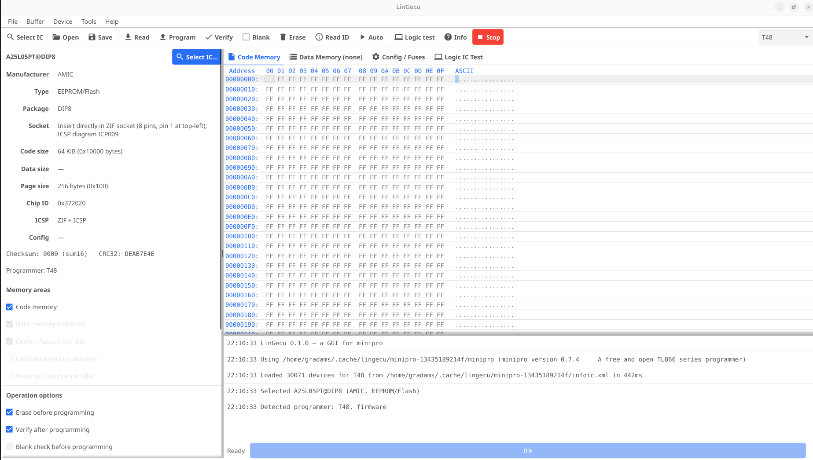

# LinGecu

LinGecu is a desktop GUI for XGecu chip programmers (TL866A/CS, TL866II+, T48, T56, T76) on Linux.
It is written in Go with [Fyne](https://fyne.io) and runs the open source
[minipro](https://gitlab.com/DavidGriffith/minipro) driver underneath. minipro is built from the
vendored source and embedded in the same binary. Every chip operation is a `minipro` run, and
the exact command is shown in the log.



## Build

The repository contains the [minipro](https://gitlab.com/DavidGriffith/minipro) source in
`third_party/minipro`. `make` compiles it and embeds the binary, its device databases and udev
rules into one self-contained `build/lingecu`. On first run they're unpacked to
`~/.cache/lingecu/` (one folder per bundled version).

```sh
make deps      # Debian/Ubuntu build dependencies (needs sudo)
make           # builds minipro, then build/lingecu with minipro embedded
make run
sudo make install   # optional: installs lingecu and its .desktop entry
```

To let a normal user access the programmer over USB, use **Tools → Install USB permissions (udev
rules)** once, or copy `third_party/minipro/udev/60-minipro.rules` to `/etc/udev/rules.d/`.

Other targets:

| Target | |
|---|---|
| `make lingecu-system` | Build without embedding minipro; uses `minipro` from `$PATH` |
| `make update-minipro REF=<tag/branch/commit>` | Replace `third_party/minipro` with an upstream export (`REF` defaults to `master`) and re-apply `third_party/patches/` |
| `make test` | Unit tests plus a headless UI test against a fake `minipro` |
| `make release` | Release tarballs for **linux amd64, arm64 and armhf**, cross-built in Docker (`ARCHES="arm64"` to pick) |

### Release builds

`make release` builds a Debian 12 container (`packaging/cross/Dockerfile`) that has every target
architecture's libraries and cross compilers. It then builds each architecture from a clean copy of
the repo. The output goes to `build/release/lingecu-<version>-linux-<arch>.tar.gz` with a `.sha256`
file. Each tarball contains the single `lingecu` binary (minipro embedded), the `.desktop` file,
the udev rules, README and LICENSE. Built against glibc 2.36, the binaries run on Debian 12+,
Ubuntu 22.10+, Fedora 37+ and Raspberry Pi OS (bookworm). You need Docker, and your user must
be able to run it.

Pushing a `v*` tag to GitHub runs the same build in `.github/workflows/release.yml` and attaches
the tarballs to a GitHub release.

Settings → *minipro executable* overrides the bundled copy. T56/T76 also need `algorithm.xml`,
which XGecu owns and minipro can't redistribute. Generate it with
`third_party/minipro/dump-alg-minipro.bash` and point Settings → *algorithm.xml* at it.

## Layout

```
cmd/lingecu/          entry point
internal/
├── bundle/           embeds and unpacks minipro + databases (-tags bundled)
├── devicedb/         infoic.xml / logicic.xml parser (≈35k devices)
├── minipro/          minipro runner: args, progress parsing, y/n prompts
├── buffer/           buffer model, bin / Intel HEX / S-record I/O, checksums
├── project/          .lgp project files
└── ui/               Fyne interface
third_party/minipro/  vendored minipro source (commit + applied patches in UPSTREAM)
third_party/patches/  LinGecu's changes to minipro, re-applied by update-minipro
scripts/              update-minipro.sh, build-release.sh
.github/workflows/    release builds on tag push
packaging/            .desktop file, cross/ (Docker cross-build)
```

## Features vs. the XGecu software

| XGecu Pro feature | LinGecu |
|---|---|
| Select IC: search, manufacturer, type, package filters, recent devices | ✔ Select IC dialog |
| Device info: size, package, adapter, ICSP, chip ID, voltages | ✔ side panel + Device → Information (also runs `minipro -d`) |
| Read / Program / Verify / Blank check / Erase / Read ID | ✔ toolbar, menu, Ctrl+R/P/E/B/I |
| Code, data (EEPROM) and config areas, chosen per operation | ✔ "Memory areas" checkboxes |
| Options: erase before, verify after, ID check, ignore ID error, pin contact check, unprotect/protect, skip blank blocks, size-mismatch policy | ✔ options panel |
| ICSP (with or without VCC) | ✔ |
| VPP / VCC / VDD / pulse delay, SPI clock, over-current limit, I²C address, eMMC partition | ✔ values depend on the selected programmer and device |
| Hex editor: edit hex/ASCII, goto, select block, find/replace, fill (pattern/random), copy block, byte swap, invert, clear | ✔ |
| Load/save Binary, Intel HEX, Motorola S-record, JEDEC; load at offset; save selection; drag & drop | ✔ |
| Checksum display; checksum calculator (sum8/16/32, word sum, XOR, CRC16, CRC32) | ✔ |
| Compare buffer with file | ✔ |
| Config / fuse / lock bits editor with per-bit checkboxes and defaults | ✔ Config / Fuses tab |
| GAL / PLD JEDEC programming | ✔ JEDEC view in Code tab |
| Logic IC test, loop testing, unknown-IC identification, SRAM test | ✔ Logic IC Test tab |
| Auto program / mass production: step sequence, chip counter, pass/fail statistics, auto-start on chip insertion | ✔ Auto window |
| Serial numbers (decimal/hex ASCII, LE/BE binary, BCD; step; persisted) | ✔ |
| SPI 25xx auto-detect (8/16 pin), identify chip by ID | ✔ Device menu |
| Pin detect: ZIF socket view showing good/bad contact per pin, checked before each operation | ✔ ZIF Socket / Pins tab (TL866II+ and T48) |
| Programmer self-test, firmware update, connected-programmer detection | ✔ Tools menu |
| Project files (device + options + buffers) | ✔ `.lgp` |
| Large parts (NAND, eMMC, ≥256 MiB) | ✔ handled file-to-file |

Some things XGecu does depend on capabilities minipro doesn't have yet, such as NAND bad-block
management schemes, VGA/HDMI EDID tools, and per-chip adapter pictures. LinGecu will expose these
once minipro supports them.

### Changes to minipro

`third_party/patches/` holds LinGecu's changes to the vendored minipro:

- `0001-t48-pin-contact-test.patch`: adds the bad-pin-contact test (`-z`) for the T48, which
  upstream only implements for the TL866II+ and T76. It also initialises the device struct used
  by the SPI auto-detect pin check.

## License

GPL-3.0-or-later (see `LICENSE`). `third_party/minipro` is minipro by Valentin Dudouyt, David
Griffith and contributors, also GPL-3.0-or-later.
